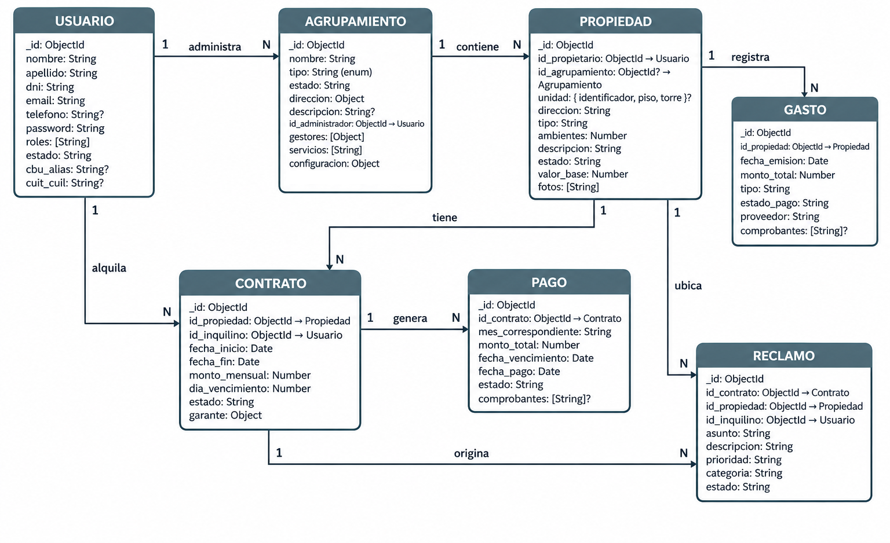

# AlquilAR

Plataforma web de gestión de alquileres con asistente de IA — Proyecto Integrador, Licenciatura en Programación (UNaHur).

## Integrantes

- Alaniz, Rocío Abril
- Díaz, Marcelo Fabián
- Torales, Santiago

**Tutor:** Prof. Alejandra Pinto

## Stack

| Capa | Tecnología |
|---|---|
| Frontend | React 19, TypeScript, Vite, Tailwind CSS |
| Backend | Node.js, Express, Mongoose |
| Base de datos | MongoDB Atlas |
| Auth | Argon2id, JWT (`JWT_SECRET` ≥ 32 bytes) |
| Archivos | Cloudinary (propiedades, pagos, garantes, gastos) |
| Asistente IA | Google Gemini (`GEMINI_API_KEY`) |
| Deploy | Render (MVP académico) |

## Estructura del repositorio

```text
.
├── backend/
│   ├── index.js                 # Express, GET /health, montaje de rutas API
│   ├── src/
│   │   ├── controllers/         # auth, propiedad, contrato, pago, gasto, reclamo, ai, …
│   │   ├── models/              # usuario, propiedad, contrato, pago, gasto, reclamo
│   │   ├── routes/
│   │   ├── middlewares/
│   │   ├── services/            # aiService, aiToolsRegistry
│   │   └── utils/
│   ├── scripts/                 # seed-usuarios, seed-propiedades, …
│   └── test/
├── frontend/
│   ├── index.html
│   ├── public/                  # logo (favicon), assets estáticos
│   └── src/
│       ├── App.tsx              # rutas: /, /registro, /dashboard
│       ├── AuthProvider.tsx     # sesión; validación con GET /api/usuarios/me
│       ├── Dashboard.tsx
│       ├── config/api.ts
│       └── components/          # asistente, pagos, propiedades, contratos, …
└── package.json                 # npm run dev (frontend + backend)
```

## Modelo de datos (DER)

Entidades principales y relaciones (implementadas en `backend/src/models/`).



| Entidad | Atributos clave (resumen) |
|---|---|
| **Usuario** | nombre, apellido, dni, email, password, roles[], estado, telefono, cbu_alias, cuit_cuil, solicitud_propietario |
| **Propiedad** | id_propietario, id_agrupamiento, unidad.identificador, direccion, tipo, ambientes, descripcion, estado, valor_base, fotos[] |
| **Agrupamiento** | codigo, nombre, tipo, estado, direccion, descripcion, id_administrador, gestores[], contacto, servicios[], configuracion |
| **Contrato** | id_propiedad, id_inquilino, fechas, monto_mensual, dia_vencimiento, estado, garante |
| **Pago** | id_contrato, mes_correspondiente, montos, fechas, estado, comprobantes[] |
| **Gasto** | id_propiedad, fecha_emision, monto_total, tipo, estado_pago, proveedor, comprobantes[] |
| **Reclamo** | id_contrato, id_propiedad, id_inquilino, asunto, descripcion, prioridad, categoria, estado, fechas |

## Funcionalidades

### Autenticación y usuarios

- Modelo único `Usuario` con `roles: [String]` (perfil mixto: `USUARIO`, `INQUILINO`, `PROPIETARIO`, `ADMINISTRADOR`).
- Rutas en `/api/usuarios`:
  - `POST /` — registro (asigna `USUARIO`)
  - `POST /login` — JWT
  - `GET /me`, `PATCH /me` — perfil del usuario autenticado
  - `GET /` — listado (solo `ADMINISTRADOR`)
  - `GET` / `POST /solicitud-propietario` — consulta y envío de solicitud de rol propietario
  - `PATCH /:id/solicitud-propietario/aprobar` — aprobación administrativa (asigna `PROPIETARIO`)
  - `PATCH /:id/roles` — agregar roles (admin)
- Middleware: `verificarToken`, `verificarRol`.
- Frontend: al recargar la app, si hay token en `localStorage` se valida con `GET /me`; un `401`/`403` limpia la sesión y un error transitorio conserva el token y muestra un aviso.
- Perfil: vista dedicada dentro del panel; permite editar teléfono, alias/CBU y CUIT/CUIL mediante `PATCH /api/usuarios/me`.
- Los errores autenticados HTTP 401/403 cierran la sesión y eliminan el token local; los errores de conexión no eliminan credenciales.

### Propiedades y contratos

- CRUD de propiedades y contratos con permisos por rol; cuotas de pago al activar contratos; historial y garantes.
- `GET /api/propiedades` — listado con JWT: **propietario** ve sus inmuebles; **administrador** ve todos. Usuarios e inquilinos sin rol de gestión reciben 403.
- No hay catálogo público ni ingreso anónimo: login o registro obligatorio para usar la app.

### Agrupamientos de viviendas

Permiten reunir unidades bajo un mismo edificio, complejo o consorcio. Una propiedad pertenece como máximo a un agrupamiento, y su relación se guarda solo en `Propiedad.id_agrupamiento` (no se duplica en contratos, pagos, gastos ni reclamos).

- Rutas principales (JWT, respuestas `{ success, data, message }`):
  - `GET /api/agrupamientos` — visibles según el rol; filtros opcionales `tipo`, `estado`, `ciudad`, `q`, `id_propietario`.
  - `POST /api/agrupamientos` — `ADMINISTRADOR` o `PROPIETARIO`.
  - `GET /api/agrupamientos/:id`, `PUT /api/agrupamientos/:id` — administrador del agrupamiento o gestor; el `ADMINISTRADOR` puede todo.
  - `DELETE /api/agrupamientos/:id` — solo `ADMINISTRADOR`; baja lógica (`INACTIVO`). Responde `409` si quedan propiedades activas.
- Asignación y desasignación: `PUT /api/propiedades/:id` con `id_agrupamiento` y `unidad.identificador`. También se aceptan al crear la propiedad. Cambiar de agrupamiento responde `409`.
- `unidad.identificador` es único dentro de cada agrupamiento. Sin `id_agrupamiento`, las propiedades siguen funcionando igual que antes.
- Filtros opcionales `?id_agrupamiento=<id>` en propiedades, contratos, pagos, gastos, reclamos y dashboard. Nunca amplían los permisos del usuario: siempre se cruzan con su alcance habitual. `GET /api/propiedades?sin_agrupamiento=true` lista las unidades sueltas.
- Panel: `AgrupamientosPanel` para el CRUD, selector global en el encabezado para acotar el resto de las vistas y AI opcional. Al crear o editar una propiedad se elige agrupamiento y unidad.

### Pagos, gastos y reclamos

Los endpoints requieren `Authorization: Bearer <token>`. La identidad se obtiene del JWT.

- **Pagos:** `GET/POST /api/pagos`, `GET/PUT/DELETE /api/pagos/:id`, comprobantes (`POST/GET/DELETE …/comprobantes`), `PATCH …/confirmar`. Cuotas automáticas al activar contrato (depósito `DEPOSITO` + mensuales `YYYYMM`). Estados `PENDIENTE`, `ATRASADO`, `INGRESADO`, `PAGADO`.
- **Gastos:** `GET/POST /api/gastos`, `GET/PUT/DELETE /api/gastos/:id`, filtros por propiedad, fechas y `estado_pago`.
- **Reclamos:** `GET/POST /api/reclamos`, `GET /api/reclamos/:id`, `PATCH …/estado`, `DELETE`. El inquilino abre reclamos sobre contratos vigentes; propietario y administrador gestionan los de sus propiedades.

### ALQUI — asistente IA

- `POST /api/ai/chat` — requiere JWT; body `{ mensajes, contexto?, intencion? }`. `contexto.id_agrupamiento` es opcional y se valida contra los agrupamientos visibles antes de usarlo.
- Consultas predefinidas deterministas: `intencion: "RESUMEN_EDIFICIO"` o `"MIS_SALDOS"`. No dependen de que el modelo decida ejecutar una herramienta: usan los servicios y datos reales con la identidad del token.
- Modelo: `GEMINI_MODEL` (opcional; por defecto `gemini-3.8-flash`). Si el proveedor responde 404, el backend consulta los modelos disponibles y reintenta una vez con un modelo alternativo.
- Límites: hasta **10** mensajes por request y **4000** caracteres por mensaje; el último mensaje debe ser del usuario. El turno completo tiene timeout de 50 s (20 s por llamada) y hasta 3 rondas de herramientas.
- Herramientas (`aiToolsRegistry.js`): cuatro.
  - `consultarDatosAlquiler`: consulta contratos y pagos visibles según el rol.
  - `consultarFinanzas`: saldos, análisis de comprobantes y borrador de recordatorio de mora.
  - `consultarResumenAgrupamiento`: métricas consolidadas de un edificio o agrupamiento.
  - `gestionarReclamos`: lista contratos vigentes del inquilino, lista reclamos visibles, clasifica una incidencia y crea el reclamo con validación en los controladores existentes.
- Errores tipados: `SIN_PERMISO`, `VALIDACION`, `NO_ENCONTRADO`, `CONFIGURACION`, `AUTENTICACION_PROVEEDOR`, `MODELO_INEXISTENTE`, `LIMITE_PROVEEDOR`, `PROVEEDOR`, `TIMEOUT`, `PASOS_EXCEDIDOS` e `INTERNO`. Los problemas de permisos se responden dentro de la conversación (HTTP 200) para no cerrar la sesión del usuario; los fallos técnicos devuelven un mensaje comprensible y un código, sin exponer detalles internos.
- Estilo de respuesta: todas las contestaciones (incluidas las consultas predefinidas y las que usan herramientas) se presentan en texto natural y conversacional, sin JSON, bloques de código, nombres de herramientas, códigos internos ni viñetas. Los datos se traducen a frases con montos, fechas y estados legibles. El backend descarta cualquier salida técnica que el modelo devuelva por error.
- Seguridad: la identidad y los permisos se resuelven solo con el JWT; las herramientas ignoran IDs de usuario enviados por el modelo y rechazan campos no autorizados. Las acciones que crean datos no se reintentan automáticamente.
- UI: chat flotante ALQUI para inquilinos, propietarios y administradores. Antes de enviar recorta el historial a los últimos **10** mensajes y limita cada mensaje a **4000** caracteres. Muestra errores del backend, permite cancelar solicitudes y reintentar manualmente; si un fallo de red o timeout impide confirmar si un reclamo se creó, pide revisar “Mis reclamos” antes de reintentar. El historial **no** se persiste en MongoDB.

## Requisitos

- Node.js 18+
- Cuenta MongoDB Atlas (configurar `MONGODB_URI` en `.env`)

## Backend

```bash
cd backend
npm install
# Crear backend/.env con MONGODB_URI y JWT_SECRET (sin commitear)
node index.js
# o desde la raíz: npm run backend
```

Variables de entorno (nombres):

- `MONGODB_URI`
- `JWT_SECRET`
- `GEMINI_API_KEY`
- `GEMINI_MODEL` (opcional; si se omite se usa `gemini-3.8-flash` y, ante un 404, se descubre un modelo disponible)
- `PORT` (opcional, default 3000)
- `SEED_PASSWORD` (opcional, default `ClaveTest123` para seeds)
- `CLOUDINARY_CLOUD_NAME`, `CLOUDINARY_API_KEY`, `CLOUDINARY_API_SECRET`
- `CORS_ORIGINS` (opcional, orígenes extra separados por coma)
- `NODE_ENV` (`production` habilita CORS estricto)
- `RENDER` (`true` también habilita CORS estricto en Render)

`JWT_SECRET` debe tener al menos 32 bytes; el backend no inicia si falta o es demasiado corta.

### CORS

Los orígenes permitidos se centralizan en `backend/src/config/corsOptions.js`:

- **Producción** (`NODE_ENV=production` o `RENDER=true`): solo la lista explícita
  (`https://alquilar-app.onrender.com` por defecto) más lo que se agregue en
  `CORS_ORIGINS`, separado por comas. Ejemplo:
  `CORS_ORIGINS=https://mi-front.example.com,https://admin.example.com`.
- **Desarrollo**: además de la lista explícita, se acepta cualquier puerto de
  `http://localhost:<puerto>` y `http://127.0.0.1:<puerto>` (Vite en 5173/5174,
  `vite preview` en 4173, etc.).

Si un origen no está permitido, el navegador bloquea la respuesta y `fetch`
falla con `Failed to fetch`; no es un problema de credenciales.

Generar secreto: `node -e "console.log(require('crypto').randomBytes(32).toString('hex'))"`.

Cloudinary: configurar credenciales en `backend/.env` y presets unsigned en el front (`VITE_CLOUDINARY_*`). No exponer `API_SECRET` en el frontend.

### Seeds

Los seeds solo agregan datos que no existen; no vacían colecciones:

```bash
cd backend
npm run seed
npm run seed:propiedades
```

Tras cambios de usuario o re-seed: limpiar `localStorage` (`token_arquilar`, `usuario_arquilar`).

## Frontend

```bash
cd frontend
npm install
npm run dev
# o desde la raíz: npm run frontend
```

En desarrollo el front usa `http://localhost:3000` como API si no se define
`VITE_API_URL` (`frontend/src/config/api.ts`).

El tema claro/oscuro puede cambiarse desde el botón del encabezado; la selección se conserva en `localStorage` (`alquilar_theme`) y, si todavía no existe, se toma de la preferencia del sistema. La paleta del tema usa violeta para acciones principales y verde agua para acciones secundarias y el chat.

En producción el front usa `VITE_API_URL`; si falta, cae al backend documentado
(`https://alquilar-pmdp.onrender.com`) y deja un warning en la consola del
navegador. Definí la variable en Render para evitar depender del fallback.

El cliente HTTP común (`frontend/src/lib/apiClient.ts`) aplica un timeout de
45 segundos y un reintento automático ante errores de red o timeout (no ante
respuestas HTTP). Mientras reintenta, el login muestra un aviso de que el
servidor puede estar iniciando.

### Variables (`frontend/.env`)

| Variable | Uso |
|---|---|
| `VITE_API_URL` | URL del backend (ej. `https://alquilar-pmdp.onrender.com`) |
| `VITE_CLOUDINARY_CLOUD_NAME` | Cloud name |
| `VITE_CLOUDINARY_UPLOAD_PRESET_PROPIEDADES` | Fotos → `alquilar/propiedades` |
| `VITE_CLOUDINARY_UPLOAD_PRESET_GASTOS` | Comprobantes de gastos |
| `VITE_CLOUDINARY_UPLOAD_PRESET` | Legacy si falta preset de propiedades |

Recibos de garante: carga autenticada vía backend. Comprobantes de pago: descarga privada firmada desde el API.

## Ambos a la vez

```bash
npm install
npm run dev
```

## CI (GitHub Actions)

[`.github/workflows/ci.yml`](.github/workflows/ci.yml) en pushes y PRs a `develop` y `main`:

| Job | Validación |
|---|---|
| **backend** | `npm test` (auth, propiedades, contratos, pagos, gastos, reclamos, IA) + syntax de `index.js` |
| **frontend** | `npm run build` |

```bash
cd backend && npm test
cd frontend && npm run lint   # opcional local
```

## Ramas

| Rama | Uso |
|---|---|
| `main` | Demo estable (Render) |
| `develop` | Integración del equipo |
| `feature/*`, `fix/*` | Trabajo por tema |

Flujo: rama de trabajo → Pull Request a `develop` → merge a `main` en hitos de demo.

## Demo (Render)

- Frontend: https://alquilar-app.onrender.com/
- Backend: https://alquilar-pmdp.onrender.com/
- Health: `GET /health` en el backend (`ok`, estado de Mongo)

En el plan gratuito de Render el backend se suspende por inactividad y el primer
request puede tardar hasta un minuto. El cliente reintenta automáticamente y
muestra un aviso; si el primer intento falla, esperá unos segundos y volvé a
intentar. Para evitarlo, usar una instancia always-on o el plan pago de Render.

Variables a configurar en Render:

- **Backend**: `MONGODB_URI`, `JWT_SECRET`, `GEMINI_API_KEY`, `NODE_ENV=production`,
  `CLOUDINARY_*`, opcionalmente `GEMINI_MODEL` y, si hace falta, `CORS_ORIGINS`.
- **Frontend** (build): `VITE_API_URL=https://alquilar-pmdp.onrender.com` y los
  `VITE_CLOUDINARY_*`. En Vite las variables `VITE_*` se leen al compilar: hay que
  redeployar después de cambiarlas.

Credenciales de prueba: solicitar al equipo (no publicar en el repo).

## Documentación

- **Plan de trabajo:** Drive de la cátedra.
- **Seguimiento:** https://github.com/users/marcelofabiandiaz-unahur/projects/1
- **Repositorio:** https://github.com/marcelofabiandiaz-unahur/alquilAr
