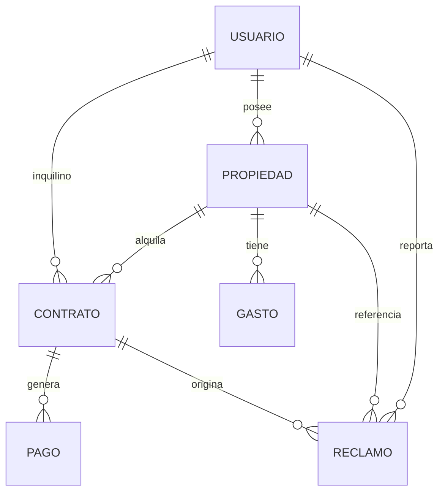

# AlquilAR

Plataforma web de gestión de alquileres con asistente de IA — Proyecto Integrador, Licenciatura en Programación (UNaHur).

## Integrantes

- Alaniz, Rocío Abril
- Díaz, Marcelo Fabián
- Torales, Santiago

**Tutor:** Prof. Alejandra Pinto

## Stack

| Capa | Tecnología |
|---|---|
| Frontend | React 19, TypeScript, Vite, Tailwind CSS |
| Backend | Node.js, Express, Mongoose |
| Base de datos | MongoDB Atlas |
| Auth | Argon2id, JWT (`JWT_SECRET` ≥ 32 bytes) |
| Archivos | Cloudinary (propiedades, pagos, garantes, gastos) |
| Asistente IA | Google Gemini (`GEMINI_API_KEY`) |
| Deploy | Render (MVP académico) |

## Estructura del repositorio

```text
.
├── backend/
│   ├── index.js                 # Express, GET /health, montaje de rutas API
│   ├── src/
│   │   ├── controllers/         # auth, propiedad, contrato, pago, gasto, reclamo, ai, …
│   │   ├── models/              # usuario, propiedad, contrato, pago, gasto, reclamo
│   │   ├── routes/
│   │   ├── middlewares/
│   │   ├── services/            # aiService, aiToolsRegistry
│   │   └── utils/
│   ├── scripts/                 # seed-usuarios, seed-propiedades, …
│   └── test/
├── frontend/
│   ├── index.html
│   ├── public/                  # logo (favicon), assets estáticos
│   └── src/
│       ├── App.tsx              # rutas: /, /registro, /catalogo, /dashboard
│       ├── AuthProvider.tsx     # sesión; validación con GET /api/usuarios/me
│       ├── Catalogo.tsx         # vitrina pública de alquileres
│       ├── Dashboard.tsx
│       ├── config/api.ts
│       └── components/          # asistente, pagos, propiedades, contratos, …
└── package.json                 # npm run dev (frontend + backend)
```

## Modelo de datos (DER)

Entidades principales y relaciones (implementadas en `backend/src/models/`). El diagrama académico completo está en el Drive de la cátedra.



| Entidad | Atributos clave (resumen) |
|---|---|
| **Usuario** | nombre, apellido, dni, email, password, roles[], estado, telefono, cbu_alias, cuit_cuil, solicitud_propietario |
| **Propiedad** | id_propietario, direccion, tipo, ambientes, descripcion, estado, valor_base, fotos[] |
| **Contrato** | id_propiedad, id_inquilino, fechas, monto_mensual, dia_vencimiento, estado, garante |
| **Pago** | id_contrato, mes_correspondiente, montos, fechas, estado, comprobante_url, comprobantes[] |
| **Gasto** | id_propiedad, fecha_emision, monto_total, tipo, estado_pago, proveedor, comprobantes[] |
| **Reclamo** | id_contrato, id_propiedad, id_inquilino, asunto, descripcion, prioridad, categoria, estado, fechas |

El DER del PI coincide en entidades y cardinalidades. El código agrega detalles de implementación: `solicitud_propietario` en usuarios, múltiples `comprobantes` en pagos, estados enumerados, `timestamps` de Mongoose y restricciones (por ejemplo, un solo contrato **VIGENTE** por propiedad; unicidad de cuota por contrato y período).

## Funcionalidades

### Autenticación y usuarios

- Modelo único `Usuario` con `roles: [String]` (perfil mixto: `USUARIO`, `INQUILINO`, `PROPIETARIO`, `ADMINISTRADOR`).
- Rutas en `/api/usuarios`:
  - `POST /` — registro (asigna `USUARIO`)
  - `POST /login` — JWT
  - `GET /me`, `PATCH /me` — perfil del usuario autenticado
  - `GET /` — listado (solo `ADMINISTRADOR`)
  - `GET` / `POST /solicitud-propietario` — consulta y envío de solicitud de rol propietario
  - `PATCH /:id/solicitud-propietario/aprobar` — aprobación administrativa (asigna `PROPIETARIO`)
  - `PATCH /:id/roles` — agregar roles (admin)
- Middleware: `verificarToken`, `verificarRol`.
- Frontend: al recargar la app, si hay token en `localStorage` se valida con `GET /me`; si falla, se limpia la sesión.

### Propiedades, contratos y catálogo público

- CRUD de propiedades y contratos con permisos por rol; cuotas de pago al activar contratos; historial y garantes.
- `GET /api/propiedades/disponibles` — **público** (sin JWT): listado de propiedades en estado `DISPONIBLE`.
- SPA `/catalogo` — búsqueda y filtros sin login; acceso desde login con **Continuar sin registrarse**. El resto de rutas de propiedades requiere JWT.

### Pagos, gastos y reclamos

Los endpoints requieren `Authorization: Bearer <token>` salvo el listado público de disponibles. La identidad se obtiene del JWT.

- **Pagos:** `GET/POST /api/pagos`, `GET/PUT/DELETE /api/pagos/:id`, comprobantes (`POST/GET/DELETE …/comprobantes`), `PATCH …/confirmar`. Cuotas automáticas al activar contrato (depósito `DEPOSITO` + mensuales `YYYYMM`). Estados `PENDIENTE`, `ATRASADO`, `INGRESADO`, `PAGADO`.
- **Gastos:** `GET/POST /api/gastos`, `GET/PUT/DELETE /api/gastos/:id`, filtros por propiedad, fechas y `estado_pago`.
- **Reclamos:** `GET/POST /api/reclamos`, `GET /api/reclamos/:id`, `PATCH …/estado`, `DELETE`. El inquilino abre reclamos sobre contratos vigentes; propietario y administrador gestionan los de sus propiedades.

### Asistente IA

- `POST /api/ai/chat` — requiere JWT; body `{ mensajes }` con roles `user` y `assistant`.
- Modelo: `gemini-3.8-flash` (`GEMINI_API_KEY` solo en backend).
- Límites: hasta **20** mensajes por request y **4000** caracteres por mensaje; el último mensaje debe ser del usuario.
- Herramientas (`aiToolsRegistry.js`): listar contratos vigentes del inquilino, listar reclamos visibles, crear reclamo (validación en controladores existentes; identidad solo desde JWT).
- UI: `AsistentePanel` en el dashboard para inquilinos, propietarios y administradores. El historial **no** se persiste en MongoDB.

## Requisitos

- Node.js 18+
- Cuenta MongoDB Atlas (configurar `MONGODB_URI` en `.env`)

## Backend

```bash
cd backend
npm install
# Crear backend/.env con MONGODB_URI y JWT_SECRET (sin commitear)
node index.js
# o desde la raíz: npm run backend
```

Variables de entorno (nombres):

- `MONGODB_URI`
- `JWT_SECRET`
- `GEMINI_API_KEY`
- `PORT` (opcional, default 3000)
- `SEED_PASSWORD` (opcional, default `ClaveTest123` para seeds)
- `CLOUDINARY_CLOUD_NAME`, `CLOUDINARY_API_KEY`, `CLOUDINARY_API_SECRET`

`JWT_SECRET` debe tener al menos 32 bytes; el backend no inicia si falta o es demasiado corta.

Generar secreto: `node -e "console.log(require('crypto').randomBytes(32).toString('hex'))"`.

Cloudinary: configurar credenciales en `backend/.env` y presets unsigned en el front (`VITE_CLOUDINARY_*`). No exponer `API_SECRET` en el frontend.

### Seeds

Los seeds solo agregan datos que no existen; no vacían colecciones:

```bash
cd backend
npm run seed
npm run seed:propiedades
```

Tras cambios de usuario o re-seed: limpiar `localStorage` (`token_arquilar`, `usuario_arquilar`).

## Frontend

```bash
cd frontend
npm install
npm run dev
# o desde la raíz: npm run frontend
```

En desarrollo el front usa `http://localhost:3000` como API (`frontend/src/config/api.ts`).

### Variables (`frontend/.env`)

| Variable | Uso |
|---|---|
| `VITE_CLOUDINARY_CLOUD_NAME` | Cloud name |
| `VITE_CLOUDINARY_UPLOAD_PRESET_PROPIEDADES` | Fotos → `alquilar/propiedades` |
| `VITE_CLOUDINARY_UPLOAD_PRESET_GASTOS` | Comprobantes de gastos |
| `VITE_CLOUDINARY_UPLOAD_PRESET` | Legacy si falta preset de propiedades |

Recibos de garante: carga autenticada vía backend. Comprobantes de pago: descarga privada firmada desde el API.

## Ambos a la vez

```bash
npm install
npm run dev
```

## CI (GitHub Actions)

[`.github/workflows/ci.yml`](.github/workflows/ci.yml) en pushes y PRs a `develop` y `main`:

| Job | Validación |
|---|---|
| **backend** | `npm test` (auth, propiedades, contratos, pagos, gastos, reclamos, IA) + syntax de `index.js` |
| **frontend** | `npm run build` |

```bash
cd backend && npm test
cd frontend && npm run lint   # opcional local
```

## Ramas

| Rama | Uso |
|---|---|
| `main` | Demo estable (Render) |
| `develop` | Integración del equipo |
| `feature/*`, `fix/*` | Trabajo por tema |

Flujo: rama de trabajo → Pull Request a `develop` → merge a `main` en hitos de demo.

## Demo (Render)

- Frontend: https://alquilar-app.onrender.com/
- Backend: https://alquilar-pmdp.onrender.com/
- Health: `GET /health` en el backend (`ok`, estado de Mongo)

Credenciales de prueba: solicitar al equipo (no publicar en el repo).

## Documentación

- **Plan de trabajo:** Drive de la cátedra (Gantt, DER académico, entregables).
- **Seguimiento:** https://github.com/users/marcelofabiandiaz-unahur/projects/1
- **Resumen técnico en el repo:** [`docs/Resumen-Tecnico-Estado-Reparto-Trabajo.md`](docs/Resumen-Tecnico-Estado-Reparto-Trabajo.md)
- **Repositorio:** https://github.com/marcelofabiandiaz-unahur/alquilAr
